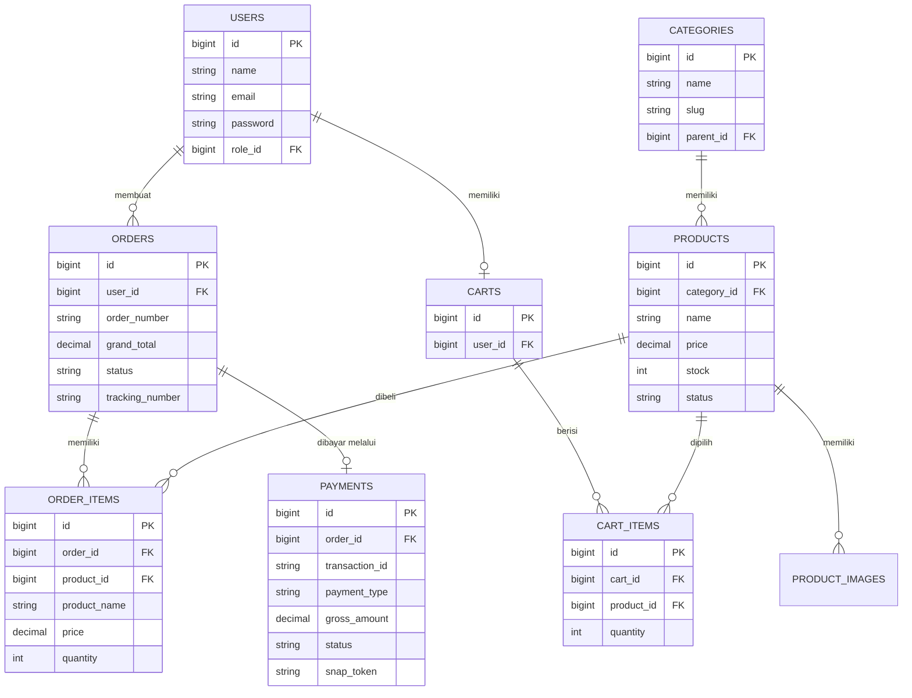

# SetUp Pedia - Gaming & Tech Setup E-Commerce Platform
> **Dokumentasi Proyek Akhir Praktikum Pemrograman E-Commerce**  
> Repositori Resmi: [ecommerce_SetUp-Pedia on GitHub](https://github.com/fikriirwnsyh21-del/ecommerce_SetUp-Pedia.git)

---

## 📋 1. Gambaran Umum Tugas & Proyek

**SetUp Pedia** adalah website e-commerce modern yang dikembangkan secara spesifik untuk memenuhi seluruh ketentuan dan rubrik penilaian pada dokumen **TUGAS BESAR PRAKTIKUM PEMROGRAMAN E-COMMERCE**. 

Sistem ini bukan sekadar katalog tampilan toko online statis, melainkan platform jual beli daring fungsional penuh (*end-to-end*) dengan arsitektur **MVC**, proteksi hak akses **2 Peran Murni (Admin & Customer)**, alur transaksi aman dengan *pessimistic row locking* untuk mencegah *race condition* stok, serta integrasi **Payment Gateway Midtrans Sandbox** resmi melalui verifikasi notifikasi *signature webhook*.

### Ringkasan Spesifikasi Teknis:
| Komponen | Spesifikasi / Teknologi yang Digunakan |
| :--- | :--- |
| **Framework Backend** | **Laravel 13** (PHP >= 8.3) |
| **Database & ORM** | **MySQL 8+** dengan Eloquent ORM, Migration, Seeder & Factory |
| **Arsitektur Sistem** | **Model-View-Controller (MVC)** + *Dedicated Service Layer* (`CartService`, `CheckoutService`, `MidtransService`, `VoucherService`) |
| **Payment Gateway** | **Midtrans Snap Sandbox** (QRIS Gopay/OVO/ShopeePay, Virtual Account BCA/BNI/BRI/Mandiri/Permata, Credit Card) |
| **Role Pengguna** | **Pure 2-Role System**: **Admin** & **Customer** (dibatasi oleh middleware ketat) |
| **Frontend & Styling** | **Blade Templating**, **Tailwind CSS v4** (`@theme` Sage Green `#507159` & Putih Abu `#f6f8f6`), **Alpine.js** |
| **Version Control & Docs** | **Git** & **GitHub Repository** |

---

## 🌟 2. Fitur Wajib Sistem Berdasarkan Peran

### A. Halaman Admin (Back-Office Toko)
Admin bertugas mengelola seluruh aspek operasional toko dengan perlindungan akses melalui `RoleMiddleware`:
* **Autentikasi Admin**: Halaman login terproteksi khusus untuk pengelola sistem.
* **Dashboard Statistik Interaktif**: Menampilkan 6 metrik wajib real-time sesuai dokumen spesifikasi:
  1. *Total Produk* (seluruh katalog aktif & nonaktif)
  2. *Total Kategori* (seluruh hierarki kategori)
  3. *Total Pelanggan* (jumlah pengguna terdaftar bertipe customer)
  4. *Total Pesanan* (seluruh transaksi yang tercatat)
  5. *Pesanan Menunggu Pembayaran* (`pending`)
  6. *Pesanan Sudah Dibayar* (`paid`, `processing`, `shipped`, `delivered`, `completed`)
  7. *Grafik GMV & Recent Orders* (rincian transaksi terbaru)
* **Manajemen Kategori (CRUD)**: Tambah, lihat, edit, dan hapus kategori produk dengan *Custom Vector Icon Picker* (SVG).
* **Manajemen Produk (CRUD)**: Tambah produk baru, edit data, upload multi-gambar via `Laravel Storage` (`public/storage/products`), set harga, diskon flash sale, berat, kondisi barang, dan kelola stok realtime.
* **Manajemen Pesanan**: Melihat seluruh transaksi dari seluruh pelanggan dengan filter status pembayaran dan pencarian nomor invoice.
* **Detail Pesanan**: Menampilkan data penerima, alamat pengiriman, kurir, rincian produk yang dibeli, harga snapshot, serta histori pembayaran Midtrans.
* **Update Status Pesanan & Pengiriman**: Memperbarui alur status (`processing` → `shipped` + nomor resi kurir / `tracking_number`).
* **Proteksi Status Pembayaran**: Status pembayaran yang telah diverifikasi oleh Midtrans terkunci rapat dan **tidak dapat dimanipulasi atau diubah sembarangan** secara manual dari dashboard admin.
* **Proteksi Transaksi Admin (`CustomerOnlyMiddleware`)**: Akun admin dicegah dari melakukan checkout agar tidak mencemari pembukuan dan stok toko.

### B. Halaman Customer (Front-Store Pembeli)
Customer adalah pembeli yang bertransaksi memilih dan membeli produk perlengkapan setup:
* **Registrasi & Autentikasi**: Pendaftaran akun customer baru, login, dan logout dengan session database aman.
* **Profil Pengguna & Buku Alamat**: Pengelolaan identitas profil dan penyimpanan multi-alamat pengiriman penerima.
* **Katalog Produk & Hero Showcase**:
  * Slider banner promosi perlengkapan setup gaming.
  * Section prioritas **Laptop Gaming Flagship & Ultrabook Pilihan** di bagian teratas.
  * Section khusus **50 Produk Budget (< Rp 5 Juta)** dengan tombol filter instan.
  * Flash Sale dengan *countdown timer* real-time berbasis Alpine.js.
* **Pencarian & Filter Multi-Kriteria**: Pencarian nama produk secara instan, filter kategori, rentang harga, rating bintang, dan pengurutan (termurah, termahal, terlaris, rating tertinggi).
* **Detail Produk Interaktif**: Galeri gambar resolusi tinggi, deskripsi spesifikasi, varian produk dinamis, badge garansi resmi, dan ulasan pembeli terdahulu.
* **Shopping Cart (Keranjang Belanja)**:
  * Menambah produk atau varian ke keranjang.
  * Mengubah jumlah kuantitas dengan sinkronisasi subtotal dan validasi ketersediaan stok server.
  * Menghapus item dari keranjang atau memilih item tertentu untuk di-checkout (*checkbox partial checkout*).
  * Tombol *Beli Langsung* (*Buy Now*) langsung menuju form checkout.
* **Checkout & Pembuatan Pesanan**:
  * Pengisian data penerima, nomor telepon, dan pemilihan alamat pengiriman.
  * Pilihan kurir pengiriman (Reguler, Hemat, Express / JNE, SiCepat, GoSend).
  * Validasi voucher promo diskon platform.
  * **Perhitungan Ulang Total Harga di Server** (mencegah manipulasi angka harga di sisi browser).
* **Pembayaran Midtrans Snap (Sandbox)**:
  * Membuka popup Snap resmi langsung di layar checkout.
  * Mendukung QRIS (GoPay, OVO, ShopeePay), Virtual Account (BCA, Mandiri, BNI, BRI, Permata), dan Kartu Kredit.
  * Tombol *Perbarui Sesi Pembayaran* jika sesi Snap kedaluwarsa.
* **Riwayat Pesanan**: Pelacakan status pesanan real-time: `pending` → `paid` → `processing` → `shipped` → `delivered` → `completed` / `cancelled`.
* **Invoice Resmi**: Halaman ringkasan transaksi dengan fitur cetak faktur pembayaran (*print-ready layout*).
* **Ulasan Produk**: Memberikan rating bintang (1–5) dan ulasan teks setelah barang diterima.

---

## 🔄 3. Analisis Alur Kerja Sistem (System Workflow)

```mermaid
flowchart TD
    subgraph ALUR_ADMIN ["Alur Administrator Toko"]
        A1[Login Admin] --> A2[Dashboard Statistik Toko]
        A2 --> A3[Kelola Kategori & Produk]
        A3 --> A4[Pantau Pesanan Masuk]
        A4 --> A5[Verifikasi Status Midtrans Terkunci]
        A5 --> A6[Update Status Pemrosesan & Input Resi Pengiriman]
    end

    subgraph ALUR_CUSTOMER ["Alur Pembeli / Customer"]
        C1[Registrasi / Login Customer] --> C2[Jelajahi Katalog / Filter Laptop / Pencarian]
        C2 --> C3[Lihat Detail Produk & Spesifikasi]
        C3 --> C4[Tambah ke Keranjang Belanja]
        C4 --> C5[Halaman Checkout: Input Alamat & Pilih Kurir]
        C5 --> C6[Server Validasi Stok Atomik lockForUpdate & Hitung Total]
        C6 --> C7[Sistem Generate Midtrans Snap Token]
        C7 --> C8[Customer Membayar via Midtrans Sandbox QRIS/VA]
        C8 --> C9[Midtrans Kirim Webhook HTTP Notification]
        C9 --> C10[Server Verifikasi Signature Key & Update Status Jadi Paid]
        C10 --> C11[Customer Pantau Riwayat Pesanan & Cetak Invoice]
    end
```



### Penanganan Verifikasi Transaksi Midtrans (Kritis):
Sistem **tidak hanya mengandalkan redirect URL browser** pengguna. Verifikasi pembayaran ditangani secara andal oleh endpoint webhook:
* Route: `POST /api/midtrans/callback` dan `POST /midtrans/callback`
* Controller: `MidtransCallbackController@handle`
* Keamanan: Menghitung hash SHA-512 dari kombinasi:
  ```text
  Signature = SHA512(order_id + status_code + gross_amount + ServerKey)
  ```
* Jika signature tidak valid, request ditolak (`401 Unauthorized`).
* Jika valid, status pesanan diperbarui secara atomik. Jika transaksi batal/kedaluwarsa (`cancel`, `expire`, `deny`), stok barang otomatis dikembalikan ke inventori (*inventory rollback*).

---

## 🗄️ 4. Analisis Rancangan Database & Relasi (ERD)

Struktur tabel mematuhi kaidah relasional pihak ketiga, normalisasi data, serta menjaga snapshot harga historis pesanan (*price freeze*).

### Tabel Database Utama:
1. `users`: Menyimpan akun pengguna dengan kolom `role_id` (Admin / Customer).
2. `categories`: Menyimpan data kategori produk (hierarki *parent-child*, nama, slug, ikon SVG).
3. `products`: Menyimpan katalog barang (nama, slug, deskripsi, harga, stok, kondisi, berat, status).
4. `product_images`: Menyimpan berkas gambar produk di `storage/products`.
5. `carts`: Menyimpan header keranjang belanja per pengguna (`user_id`).
6. `cart_items`: Menyimpan baris produk dan kuantitas dalam keranjang belanja.
7. `orders`: Menyimpan header transaksi pesanan (nomor invoice, total harga, ongkir, diskon, alamat pengiriman, status pesanan, resi pengiriman).
8. `order_items`: Menyimpan rincian produk yang dibeli beserta **salinan snapshot nama produk dan harga jual saat transaksi terjadi** (menjamin riwayat tidak terdistorsi bila harga katalog diedit kemudian).
9. `payments`: Menyimpan rincian transaksi Midtrans (order ID Midtrans, metode bayar, snap token, status transaksi, payload respons).

### Diagram Relasi Database (Mermaid ERD):


---

## 💳 5. Analisis Integrasi Midtrans (Bobot Penilaian 15%)

Integrasi Midtrans diimplementasikan dengan kepatuhan penuh terhadap standar keamanan e-commerce:

1. **Server-Side Price Calculation**: Nilai `gross_amount` dihitung ulang secara mutlak di backend dari database, bukan dari input form HTML.
2. **Pessimistic Locking Concurrency**: Menggunakan `DB::transaction()` dan `Product::lockForUpdate()` saat checkout dibuat, menjamin stok tidak akan pernah bernilai negatif walaupun ratusan pelanggan membeli produk yang sama secara serentak.
3. **Midtrans Snap Engine**: Mengirimkan parameter `transaction_details`, `item_details`, dan `customer_details` ke endpoint API Midtrans untuk mendapatkan `snap_token`.
4. **Matriks Penanganan Status Transaksi**:
   | Status dari Midtrans | Status Pesanan di Sistem | Penanganan Sistem & Inventori |
   | :--- | :--- | :--- |
   | `pending` | `pending` | Menunggu pembeli menyelesaikan pembayaran. |
   | `settlement` | `paid` | Pembayaran berhasil diverifikasi, siap diproses admin. |
   | `capture` (accept) | `paid` | Pembayaran kartu kredit terkonfirmasi berhasil. |
   | `expire` | `cancelled` | Waktu bayar habis; stok barang dikembalikan otomatis (*inventory rollback*). |
   | `cancel` | `cancelled` | Pembeli/admin membatalkan pesanan; stok barang dikembalikan otomatis. |
   | `deny` | `cancelled` | Pembayaran ditolak oleh bank; pesanan digagalkan. |

---

## 📊 6. Matriks Pemenuhan Rubrik Penilaian (100%)

Proyek SetUp Pedia dirancang untuk memenuhi nilai optimal pada setiap butir evaluasi dosen:

| No | Komponen Penilaian | Bobot | Bukti Implementasi pada SetUp Pedia |
| :---: | :--- | :---: | :--- |
| **1** | **Fungsionalitas Admin** | **15%** | Halaman `/admin/dashboard` dengan 6 statistik wajib, CRUD kategori (`CategoryController`), CRUD produk (`ProductController`), inspeksi pesanan, update resi pengiriman, dan pembatasan hak akses manual pembayaran. |
| **2** | **Fungsionalitas Pelanggan** | **15%** | Registrasi & Login, katalog produk, pencarian real-time, filter kategori & harga, galeri produk, varian dinamis, pengelolaan profil, multi-alamat, dan ulasan bintang/komentar. |
| **3** | **Shopping Cart, Checkout & Order** | **15%** | Keranjang dinamis (`CartController`), validasi stok realtime, checkout form penerima & kurir (`CheckoutController`), mitigasi *race condition* stok dengan `lockForUpdate`, riwayat status pesanan, serta cetak invoice. |
| **4** | **Integrasi Midtrans** | **15%** | `MidtransService` Snap Sandbox, popup bayar QRIS/VA, webhook notifikasi `MidtransCallbackController` dengan verifikasi SHA-512 signature hash, dan otomatisasi *inventory rollback*. |
| **5** | **Database dan Relasi** | **10%** | Skema 10+ tabel MySQL, relasi Eloquent (`hasMany`, `belongsTo`, `belongsToMany`), integrasi migration, data seeder lengkap (`UserSeeder`, `CategorySeeder`, `BudgetProductsSeeder`), dan snapshot harga di `order_items`. |
| **6** | **Authentication & Middleware** | **10%** | Laravel Auth session terenkripsi, pemisahan role Admin & Customer dengan `RoleMiddleware`, penguncian checkout admin dengan `CustomerOnlyMiddleware`, dan proteksi rute API dengan Laravel Sanctum. |
| **7** | **UI/UX dan Responsivitas** | **10%** | Desain modern responsif (mobile, tablet, desktop) menggunakan Tailwind CSS v4 palet **Hijau Sage** (`#507159`), kartu produk elegan, slider promosi, ikon vektor SVG, dan interaktivitas Alpine.js. |
| **8** | **Pengujian Fungsionalitas** | **5%** | Unit & Feature tests (`tests/Feature/AuthTest.php`, simulasi checkout, validasi keranjang, pengujian route admin & customer). |
| **9** | **GitHub & Dokumentasi** | **5%** | Repositori GitHub terstruktur rapi, commit history deskriptif, file `.env.example`, panduan instalasi lengkap, dan dokumentasi arsitektur di README ini. |
| **TOTAL** | | **100%** | **Memenuhi Seluruh Syarat Dokumen Tugas Besar Praktikum E-Commerce** |

---

## 🔐 7. Akun Uji Coba Default (Demo Credentials)

Untuk mempermudah demonstrasi dan evaluasi dosen penguji, sistem menyediakan tombol **1-Click Demo Login** pada halaman `/login`:

| Peran (Role) | Email Login | Kata Sandi | Halaman Akses | Catatan Akses |
| :--- | :--- | :--- | :--- | :--- |
| **Super Admin** | `admin@example.com` | `password` | `/admin/dashboard` | Akses penuh statistik, kategori, produk, dan resi pesanan. |
| **Pelanggan (Customer)** | `customer@example.com` | `password` | `/` (Beranda Toko) | Akses katalog, belanja gear, checkout Midtrans, riwayat & invoice. |

---

## 🛠️ 8. Panduan Instalasi & Menjalankan Proyek

### Kebutuhan Sistem:
- **PHP** >= 8.3 (ekstensi aktif: `pdo_mysql`, `mbstring`, `openssl`, `fileinfo`, `gd`, `curl`)
- **MySQL** >= 8.0 (atau Laragon / XAMPP)
- **Composer** >= 2.x
- **Node.js** >= 18.x & **NPM**

### Langkah-Langkah Menjalankan:
1. **Clone Repository GitHub**:
   ```bash
   git clone https://github.com/fikriirwnsyh21-del/ecommerce_SetUp-Pedia.git
   cd ecommerce_SetUp-Pedia
   ```

2. **Setup Konfigurasi Environment**:
   Salin file `.env.example` menjadi `.env`:
   ```bash
   cp .env.example .env
   ```
   Pastikan konfigurasi database dan kredensial Midtrans Sandbox terisi pada `.env`:
   ```env
   DB_CONNECTION=mysql
   DB_HOST=127.0.0.1
   DB_PORT=3306
   DB_DATABASE=ecommerce
   DB_USERNAME=root
   DB_PASSWORD=

   # Midtrans Sandbox Payment Gateway
   MIDTRANS_SERVER_KEY=SB-Mid-server-your-server-key-here
   MIDTRANS_CLIENT_KEY=SB-Mid-client-your-client-key-here
   MIDTRANS_IS_PRODUCTION=false
   MIDTRANS_SNAP_URL=https://app.sandbox.midtrans.com/snap/snap.js
   ```

3. **Install Dependensi Composer & Generate App Key**:
   ```bash
   composer install
   php artisan key:generate
   ```

4. **Jalankan Migrasi Database & Seeder**:
   ```bash
   php artisan migrate:fresh --seed
   ```
   *(Perintah ini akan membuat seluruh tabel, akun admin & customer demo, kategori perlengkapan setup, serta puluhan produk laptop dan aksesoris).*

5. **Hubungkan Storage Gambar**:
   ```bash
   php artisan storage:link
   ```

6. **Build Aset Frontend (Tailwind CSS v4 & Alpine.js)**:
   ```bash
   npm install
   npm run build
   ```

7. **Jalankan Server Lokal**:
   ```bash
   php artisan serve
   ```
   Buka peramban (*browser*) Anda di: `http://localhost:8000`

---

## 🧪 9. Pengujian & Pengetesan Fitur Transaksi Midtrans Sandbox

Untuk menguji alur pembayaran Midtrans di lingkungan lokal:
1. Login sebagai **Pelanggan** (`customer@example.com`).
2. Masukkan produk ke keranjang lalu klik **Checkout**.
3. Isi data pengiriman dan pilih kurir, lalu klik **Bayar Sekarang**.
4. Popup **Midtrans Snap** akan muncul di layar. Pilih metode pembayaran:
   * **QRIS**: Gunakan aplikasi simulator Midtrans QRIS atau klik *Simulate Payment*.
   * **Bank Virtual Account**: Salin nomor VA dan bayar melalui [Midtrans Payment Simulator](https://simulator.sandbox.midtrans.com/).
5. Setelah pembayaran berhasil, webhook Midtrans akan memicu update status pesanan menjadi `paid`.
6. Buka **Riwayat Pesanan** untuk melihat perubahan status dan klik tombol **Cetak Invoice** untuk melihat faktur resmi.
7. Login sebagai **Super Admin** (`admin@example.com`), buka menu **Pesanan**, lalu verifikasi bahwa pesanan telah berstatus dibayar dan masukkan nomor resi pengiriman kurir.

---

## 📁 10. Struktur Direktori Proyek

```
ecommerce/
├── app/
│   ├── Http/
│   │   ├── Controllers/
│   │   │   ├── Admin/              # Dashboard, Kategori, Produk, Pesanan, User
│   │   │   ├── Customer/           # Riwayat Pesanan, Profil, Alamat
│   │   │   ├── Auth/               # Login, Register, Password Reset
│   │   │   ├── CartController.php
│   │   │   ├── CheckoutController.php
│   │   │   ├── HomeController.php
│   │   │   ├── ProductController.php
│   │   │   └── MidtransCallbackController.php  # Webhook Verifier Midtrans
│   │   └── Middleware/
│   │       ├── RoleMiddleware.php
│   │       └── CustomerOnlyMiddleware.php
│   ├── Models/                     # User, Product, Category, Cart, Order, Payment, dll.
│   └── Services/                   # CartService, CheckoutService, MidtransService, BudgetProductsSeeder
├── database/
│   ├── migrations/                 # Migrasi seluruh tabel relational
│   └── seeders/                    # DatabaseSeeder, UserSeeder, CategorySeeder, ProductSeeder
├── resources/
│   ├── views/
│   │   ├── admin/                  # Dashboard statistik & Back-office views
│   │   ├── customer/               # Riwayat pesanan & Invoice view
│   │   ├── cart/                   # Shopping cart views
│   │   ├── checkout/               # Checkout form & Midtrans popup trigger
│   │   ├── products/               # Katalog & detail produk
│   │   └── layouts/                # Admin & Storefront layouts
│   └── css/app.css                 # Tailwind CSS v4 configuration (@theme Sage Green)
├── routes/
│   ├── web.php                     # Route web storefront & admin panel
│   └── api.php                     # REST API v1 endpoints (Sanctum) & Midtrans webhook
└── README.md                       # Dokumentasi resmi tugas besar
```

---
*Dibuat dengan dedikasi untuk memenuhi standar akademis Tugas Besar Praktikum Pemrograman E-Commerce.*
